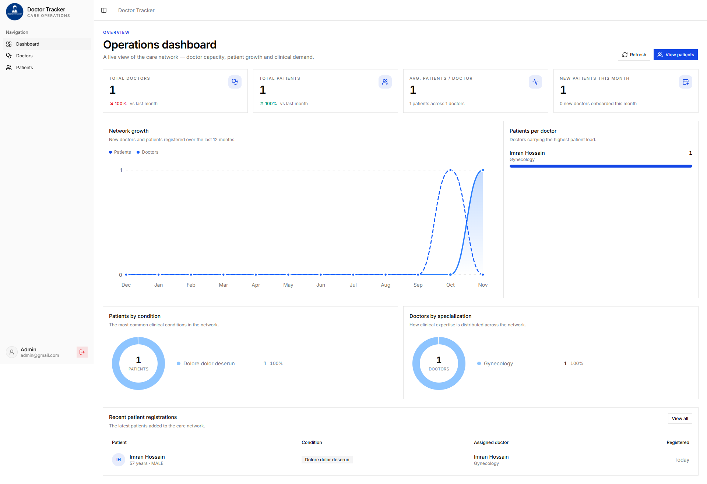
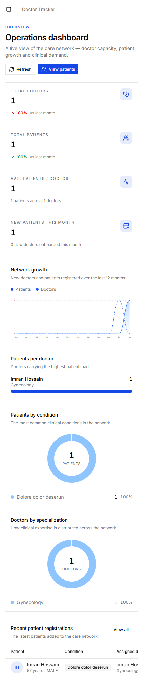
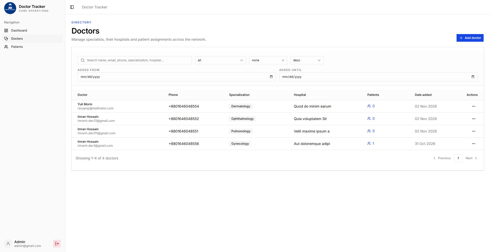
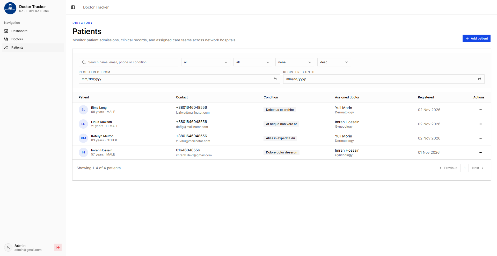

# Doctor Tracker

Doctor Tracker is a secure, responsive administrative web application for managing doctors and their patients from one place. It provides an admin dashboard with key statistics, doctor and patient management, search, filtering, and pagination to support efficient day-to-day healthcare administration.

## Features

- **Authentication:** Secure admin login and protected application routes.
- **Dashboard:** Overview of doctor and patient totals, patient distribution, and date-based statistics with visual charts.
- **Doctor management:** Create and view doctor records, search and filter the list, and paginate results.
- **Doctor–patient management:** View patients assigned to a doctor, add patients, and remove patients from the doctor's list.
- **Patient management:** View, search, filter, paginate, edit, and delete patient records.
- **Validation and error handling:** Validate incoming data and return consistent API errors.
- **Database performance:** MongoDB indexes and efficient query patterns for common searches and filters.
- **Responsive UI:** Navigation and layouts designed for desktop and mobile screens.


## Tech Stack

### Frontend
- Next.js
- React
- TypeScript
- Tailwind CSS


### Backend
- Node.js
- Express
- TypeScript
- MongoDB
- Zod (request validation, if used)
- JSON Web Token / cookie-based authentication

### Tooling
- Bun
- Git and GitHub
  
## Repository Structure

This project uses separate frontend and backend applications.

```text
doctor-tracker/
├── frontend/     # Next.js client application
└── backend/      # Express REST API
```

The exact internal structure may differ. Refer to each application's source tree for implementation details.

## System Architecture

```text
Admin
  |
  v
Next.js Frontend
  |  HTTPS requests to REST endpoints
  v
Express API (Node.js)
  |-- Authentication and authorization
  |-- Request validation
  |-- Doctor and patient business logic
  |-- Search, filtering, sorting, and pagination
  |
  v
MongoDB
  |-- Users / admin accounts
  |-- Doctors
  |-- Patients
  |-- Indexes for frequently queried fields
```

1. The administrator signs in through the Next.js frontend.
2. The frontend sends requests to the Express API using the configured API base URL.
3. The API validates the request and verifies the user's authentication and permissions.
4. The API queries or updates MongoDB and returns a JSON response.
5. The frontend renders the returned data and updates dashboard metrics and charts.

The exact authentication flow and collection names should be documented according to the implementation.

## Prerequisites

Install the following before running the project locally:

- [Bun](https://bun.sh/) or the package manager configured by the project
- A supported Node.js version if required by your scripts
- A MongoDB database, such as MongoDB Atlas or a local MongoDB instance
- Git

## Local Setup

### 1. Clone the repositories

If the frontend and backend are separate repositories, clone both:

```bash
git clone https://github.com/imranh-dev1/doctor-tracker/tree/main/frontend
git clone https://github.com/imranh-dev1/doctor-tracker/tree/main/frontend
```

Open each repository in a terminal for the following steps.

### 2. Configure the backend

```bash
cd <backend-directory>
bun install
```

Create a `.env` file from the example:

```bash
cp .env.example .env
```

On Windows PowerShell, you can use:

```powershell
Copy-Item .env.example .env
```

Fill in the required values in `backend/.env`. Use your own development database and secrets; do not commit the `.env` file.

Example `.env.example` (adjust the names to match your configuration):

```dotenv
PORT=5000
NODE_ENV=development
MONGODB_URI=mongodb://127.0.0.1:27017/doctor_tracker
JWT_SECRET=replace_with_a_long_random_secret
FRONTEND_URL=http://localhost:3000
```

If your application uses cookie settings, an access-token secret, refresh-token secret, or other environment variables, document them here as well. Never put real credentials in this file.

Run the backend using the scripts defined in `backend/package.json`. For example:

```bash
bun run dev
```

If the project uses a different script name, replace the command with the actual script.

### 3. Configure the frontend

```bash
cd <frontend-directory>
bun install
```

Create `frontend/.env.local` and set the backend API base URL. Example:

```dotenv
NEXT_PUBLIC_API_URL=http://localhost:5000/api
```

Change the variable name and URL to match the frontend API client in your codebase.

Start the frontend using the script defined in `frontend/package.json`. For example:

```bash
bun run dev
```

Open [http://localhost:3000](http://localhost:3000) in your browser, or use the URL printed by the development server.

### 4. Create or seed an admin account

Use the project's admin seed script if one is provided. Check the backend `package.json` for the exact command.

If a seed script is not included, create an admin account through your documented, secure setup process. Do not publish a real production admin password in the repository.

## Environment Variables

Document every environment variable required by the actual application.

| Variable | Application | Purpose | Example |
|---|---|---|---|
| `PORT` | Backend | Express server port | `5000` |
| `NODE_ENV` | Backend | Runtime environment | `development` |
| `MONGODB_URI` | Backend | MongoDB connection string | `mongodb://127.0.0.1:27017/doctor_tracker` |
| `JWT_SECRET` | Backend | Secret used to sign JWTs, if applicable | Placeholder only |
| `FRONTEND_URL` | Backend | Allowed frontend origin for CORS | `http://localhost:3000` |
| `NEXT_PUBLIC_API_URL` | Frontend | Base URL used by the API client | `http://localhost:5000/api` |

These are examples, not a guarantee of the variable names used by the project. Keep this table synchronized with the actual configuration files.

## API Overview

Replace or expand the examples below with the real routes and HTTP methods implemented by the backend.

| Area | Example endpoint | Purpose |
|---|---|---|
| Authentication | `POST /api/auth/login` | Sign in as an administrator |
| Authentication | `POST /api/auth/logout` | End the authenticated session, if supported |
| Dashboard | `GET /api/dashboard` | Retrieve dashboard metrics, if supported |
| Doctors | `GET /api/doctor` | List doctors with query parameters |
| Doctors | `POST /api/doctor` | Create a doctor |
| Doctor patients | `GET /api/doctor/:doctorId/patient` | List patients assigned to a doctor |
| Doctor patients | `POST /api/doctor/:doctorId/patient` | Add a patient to a doctor |
| Patients | `GET /api/patient` | List patients with query parameters |
| Patients | `PATCH /api/patient/:patientId` | Update a patient |
| Patients | `DELETE /api/patient/:patientId` | Delete a patient |

Example list query parameters may include `page`, `limit`, `search`, `startDate`, `endDate`, and `condition`. Only document parameters that your API actually supports.

## Technical Decisions

### 1. MongoDB indexes and query patterns

Doctor and patient lists commonly require searching, filtering, sorting, and pagination. MongoDB indexes can reduce the amount of data examined for frequently queried fields. Indexes should be selected based on real query patterns—for example, fields used for date filters, patient conditions, doctor references, or common search operations.

The backend should apply filtering and pagination in MongoDB rather than loading an entire collection into the frontend. For predictable results, sorting should use a stable field (and a unique tie-breaker where appropriate). Indexes should be verified against the queries the application actually runs, because unnecessary indexes increase storage use and write overhead.

### 2. Separate frontend and REST API

The frontend and backend are maintained as separate applications: Next.js handles the user interface, while Express exposes REST endpoints and owns server-side validation, authorization, and database access. This separation keeps database credentials on the server, gives the API a clear responsibility boundary, and allows the frontend and backend to be deployed independently.

The frontend should use a single configured API client and a consistent data-fetching strategy to avoid duplicated request logic. The API should validate incoming input, enforce authorization on protected routes, and return predictable response and error formats.

## Performance and Security Notes

- Apply search, filtering, sorting, and pagination on the server for larger datasets.
- Add indexes based on actual query patterns and verify them with query explain plans when appropriate.
- Validate request bodies and query parameters before database operations.
- Protect private API routes with authentication and enforce authorization on the server.
- Keep secrets and database connection strings in environment variables.
- Configure CORS for the intended frontend origin.
- Avoid returning password hashes, tokens, or other sensitive fields in API responses.
- Use consistent error responses and avoid exposing stack traces in production.
- Keep dependencies updated and avoid unnecessary frontend re-renders.

## Visual Evidence

### Dashboard — Desktop



### Dashboard — Mobile



### Doctors Page



### Patients Page



### Login Page


## Deployment

- **Frontend:** `https://doctor-tracker-ui.vercel.app/`
- **Backend API:** `https://doctor-tracker-backend-phi.vercel.app/`
- **Frontend repository:** `https://github.com/imranh-dev1/doctor-tracker/tree/main/frontend`
- **Backend repository:** `https://github.com/imranh-dev1/doctor-tracker/tree/main/backend`

## Demo Credentials

- **Email:** `admin@gmail.com`
- **Password:** `admin@`

## Future Improvements

- Automated tests for authentication and CRUD workflows
- More detailed audit logs and analytics
- Exportable reports
- Rate limiting and additional authentication protections
- Monitoring and structured production logging
